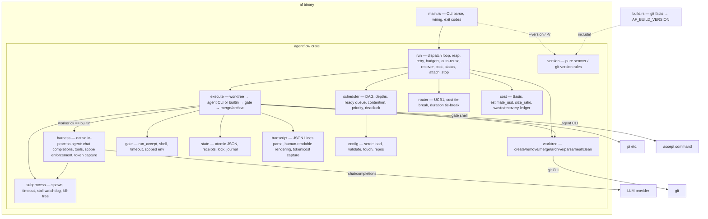
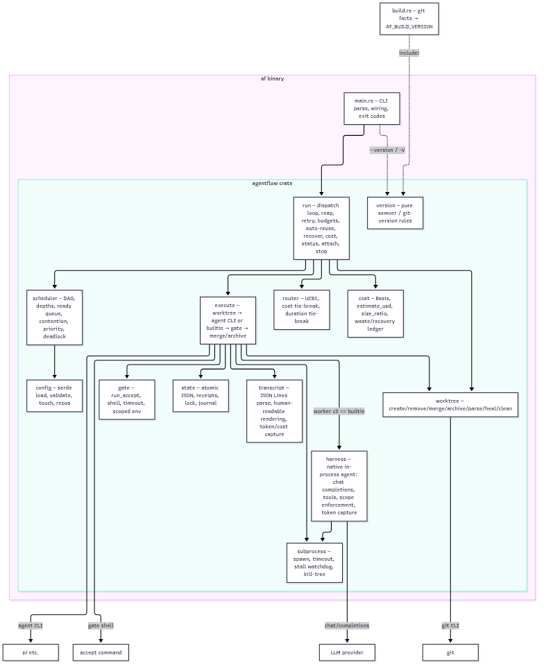

# 5. Building Block View

## 5.1 Whitebox Overall

`main.rs` reads `AF_BUILD_VERSION` (emitted by `build.rs` from git facts via
`version::compose`) for `--version`; at runtime the orchestrator never calls
`version` — it is build tooling shared verbatim with the build script.
`execute` dispatches either an external agent CLI (`pi`, opencode, …) or, when
the worker's `cli` is `"builtin"`, the in-process native harness (`harness::run`).

## 5.2 Module responsibilities and dependencies

LOC measured with `wc -l` on the current tree.

| Module | LOC | Responsibility | Depends on | Depended on by |
|--------|-----|----------------|-----------|----------------|
| `main.rs` | 599 | Parse args (`run/status/api/attach/cost/clean/recover/validate/stop`), load config, wire runtime, exit codes | `config`, `run` | — |
| `config` | 1542 | Load/validate `tasks.json`, `workers.json`, `repos.json`; `Task`, `Worker`, `WorkerDefaults`, `Settings`; `touch` validation; cycle detection | serde | `run`, `execute`, `harness`, `main` |
| `scheduler` | 575 | DAG build + depths, ready queue (deps, contention, priority, retry budget), deadlock detection — pure functions, no I/O | `config` | `run` |
| `router` | 453 | UCB1 worker selection from receipts; cost tie-break (declared basis); duration tie-break (measured mean) | `state`, `config` | `run` |
| `execute` | 1798 | Task lifecycle: worktree create → prompt render → spawn agent CLI or builtin harness → gate → merge/archive; attempt/retry loop; dirty-commit; scope check; preserve_work on every failure path | `worktree`, `gate`, `state`, `subprocess`, `transcript`, `config`, `harness` | `run`, `harness`¹ |
| `harness` | 957 | Native in-process agent for `cli: "builtin"`: OpenAI-compatible `/chat/completions` round-trips, tools (`bash`/`write`/`edit`), scope enforcement, turn caps, first-class token/cost capture (no transcript parsing) | `config`, `subprocess`, `gate` (`shell`), `execute`¹ | `execute` |
| `worktree` | 1034 | `git worktree add/remove`, branch delete, merge (serialized per repo), conflict detection, archive (`<branch>-rejected-[<attempt>-]<ts>`), parse archived name, heal stale, clean, commits_ahead, is_dirty, commit_all | git subprocess | `execute`, `run` |
| `gate` | 128 | Run `accept` shell with scoped env + timeout; exit-0 contract; replay contract (`AF_GATE_REPLAY`) | `subprocess` | `execute`, `harness` (`shell`) |
| `state` | 812 | Read/update/append `state/` JSON atomically (single writer, lock file); receipts (with `outcome`, `cost_micros`); `counts_as_verdict()`; `TaskStatus`, `AttemptPhase` | serde | `run`, `execute`, `router`, `cost` |
| `subprocess` | 545 | Spawn → optional streaming tail → wait with timeout → stall watchdog → kill-tree; `CmdKind` (Success/NonZero/Timeout/Stalled/Missing); `EnvMode` (trusted/sandbox) | std | `execute`, `gate`, `harness` |
| `transcript` | 717 | Parse JSON Lines agent transcript → human-readable log; extract `totalTokens` + `cost.total` (micro-USD); `Usage` struct | serde_json | `execute` |
| `cost` | 441 | `Basis { Priced(f64), Sized(f64) }`; `estimate_usd`; `size_ratio`; cost-basis comparison; expense classification; waste/recovery ledger | `state`, `config` | `run` |
| `run` | 4315 | Dispatch loop, reap, retry, budget caps, auto-reuse, `af recover`, `af cost`, `af status`, `af attach`, `af api`, `af stop`, hot-reload, heal stale, `branch_merged_into_head`, `CostFilter` | All | `main` |
| `version` | 120 | Pure version-composition rules (semver tag + clean tree → plain `X.Y.Z`; else `base+<count>.<sha>[.dirty]`); std-only, tested in-crate and shared verbatim with `build.rs` via `include!` | std (no crate internals) | `build.rs` (`include!`), `tests/version.rs` |

¹ `execute` and `harness` deliberately share `pub(crate)` helpers in both
directions (`scope_violations`, `agent_env`, `changed_paths`) — an inner
pairing kept out of the public API (see 5.3).

## 5.3 Dependency rules (enforced in review / CI)

- Acyclic layering: `config` / `scheduler` / `router` / `cost` / `transcript` /
  `gate` / `subprocess` / `state` / `version` import **no** other core module
  (pure data + logic); `harness` imports `config` / `subprocess` / `gate` and
  `execute` helpers; `execute` imports `worktree` / `gate` / `state` /
  `subprocess` / `transcript` / `harness`; `run` imports everything.
- The `execute` ↔ `harness` pairing is the deliberate exception: shared
  `pub(crate)` helpers (`changed_paths`, `scope_violations`, `agent_env`) are
  NOT public API and never cross into `run`.
- `state` has no core dependencies (I/O only).
- `version` is std-only; it is the single source of truth for build-time
  versions, included verbatim by `build.rs` (one implementation, compiled in
  both the crate and the build script).
- No module spawns non-child processes other than `git` / agent / gate
  subprocesses; the builtin harness talks to providers over HTTPS.
- Public functions carry **contract tests** (see 10) — total functions, defined
  exit/error contracts, no panics across module boundary except documented ones.
