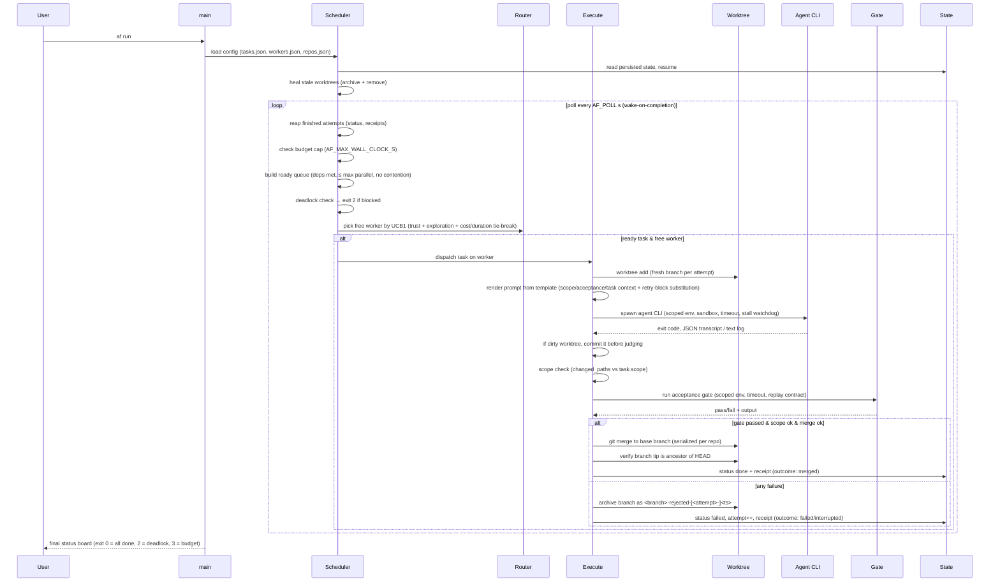
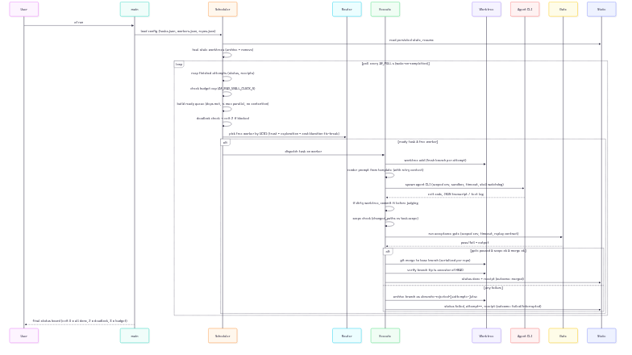

# 6. Runtime View

## 6.1 Main scenario: `af run`

## 6.2 Auto-reuse (round 13)

Before dispatching an agent for a task, `af run` looks for an archived branch
of that task whose changed paths already satisfy the task's CURRENT `scope`.
When one qualifies, it re-runs the gate on that branch and merges it — printing
`↺ <id> reused archived branch <name>` — without invoking an agent at all. A
reuse is NOT an attempt (no receipt, no worker, no cost). `AF_NO_REUSE=1`
disables it. The gate stays the sole arbiter of what merges, so reuse can only
ever save money.

## 6.3 Crash / resume scenario

- `state/` is updated **before** each visible transition — an attempt that is
  spawned but not yet recorded cannot lose work; a merge is recorded only after
  git confirms it.
- If `af` is killed: the attempt is recorded as `interrupted` (outcome, not a
  verdict) with the worker and an upper-bound duration. On restart,
  `heal_stale_attempt` archives the stale worktree's branch (preserving the
  work) and removes the worktree. State JSON is written atomically (temp +
  fsync + rename), so a torn kill never leaves corrupt JSON — a torn write is
  reported by name, never silently empty.
- A lock file (`state/state.lock`, pid-recorded) prevents two `af` processes
  from sharing one state dir; a dead pid is accepted (stale lock does not block).

## 6.4 Retry scenario

- On gate failure, scheduler increments attempt counter; if `attempt < max_attempts`
  the task is re-queued. Each retry gets a **fresh branch + fresh worktree**
  (never reuses dirty state). Release of the worker slot and re-queue obey the
  same contention/priority rules as first dispatch.
- **Gate-failure defect detection**: when a task's most recent agent-driven
  attempt dies at the acceptance gate, `af run` compares its gate-error
  fingerprint (exit code + whitespace-normalized tail) to the previous
  agent-driven gate-failed attempt of the same task. Two identical
  fingerprints with `attempts ≥ 2` mark the task `failed` immediately with
  reason `repeated identical gate failure (<tail>) — task design defect`,
  stopping further retries. Gate-only reruns (wall-clock < 5 s, no agent
  turns) are skipped as comparison targets — only two INDEPENDENT agent runs
  producing byte-identical gate output trigger the stop.
- `retry_delay_s` (default 0, opt-in) paces retries of the SAME task: after a
  failed attempt that will be retried, the task waits this many seconds before
  its next attempt starts. The wait rides the retry path only — first attempts,
  first-try merges, and other workers' dispatches are never delayed.
- **Adaptive per-worker backoff**: a worker whose attempt fails as
  infrastructure (`failure_class: "infra"` — provider 4xx/5xx, rate limit,
  transport/harness timeout) is cooled down before it can be picked again,
  escalating 30 s → 60 s → 120 s → 240 s → 300 s ceiling. Any verdict
  (merged, verified, or non-infra failed) resets the escalation to level 0.
  A solo worker (only one enabled) is capped at 30 s so the campaign keeps
  retrying rather than idling for minutes.
- Retry prompts (attempt ≥ 2) render the task's earlier failures so the agent
  avoids repeating them (ADR-13): the template's `{{PREVIOUS_ERROR}}` token
  carries the block (rendered empty on attempt 1); a template without the
  token gets the block appended. Per-task `context` (string or array) is
  injected via `{{CONTEXT}}`, and a `{{#CONTEXT}}…{{/CONTEXT}}` section drops
  when the task declares none. Gate-failure receipts carry the failing TAIL
  of the gate output (not the first banner line), so the retry prompt tells
  the next agent why the gate rejected the work.

## 6.5 Recovery scenario (`af recover`)

- `af recover --task ID [--attempt N] [--dry-run]` selects the newest archived
  branch (`<branch>-rejected-[<attempt>-]<ts>`) for the task, re-checks scope,
  re-runs the gate, and merges on success — **without re-invoking the agent**.
- `--attempt N` restricts to archives whose parsed attempt == N; without the
  flag, newest-by-ts is selected. Legacy 3-field archives (no attempt) parse as
  attempt 0.
- Exit 0 = recovered; exit 2 = nothing to recover / unknown task / no archive
  for the requested attempt; exit 1 = still fails its re-check (branch kept).
- A `recovered` receipt (outcome `"recovered"`, `wall_clock_s: 0.0`) is
  appended; `af cost` pairs it with the original failed receipt and shows a
  `RECOVERED:` line, excluding the salvaged failed receipt from `WASTED`.
- The failed attempt's receipt is never rewritten — history is append-only.

## 6.6 Cost report (`af cost`)

- The per-worker trust table shows `WORKER`, `WINS/TOTAL`, `TRUST`, `MEAN_S`,
  and `COST`. When any worker in the selection has infra-class failures, an
  `INFRA` column is inserted after `MEAN_S` (showing the count or `-`), and a
  footnote names each affected worker with its count and most recent infra
  error. An all-healthy selection (no infra failures) omits the column and
  footnote entirely — byte-identical to the pre-change report.
- The `INFRA` column narrows with the same selection (`--last`, `--since`,
  `--task`) as the rest of the report, so a worker's drift over a specific
  window is visible next to its trust.

## 6.7 Concurrency model

- One process; per-attempt threads via `std::thread::scope`; git/agent/gate run
  as subprocesses awaited with timeouts and kill-trees (no zombies).
- The **single writer** guarantees serialized state transitions; reads during
  dispatch are lock-free snapshots.
- Merges are serialized per repository (single `MergeLocks` map in-process).
- Contention: tasks whose `scope` globs overlap are not dispatched concurrently.
- The parallel ceiling is re-derived per dispatch round: with `AF_MAX_PARALLEL`
  left at the default (`0`), capacity = the current enabled-worker count of
  the reloaded `workers.json` (`pool_capacity`), so a hot reload that appends
  a worker grows the pool and one that disables a worker shrinks it — no
  restart needed. An explicit `AF_MAX_PARALLEL=N` stays a fixed ceiling.
