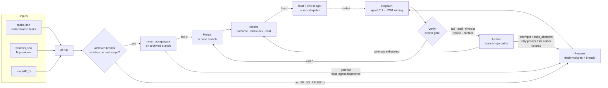

# Campaign lifecycle

`af run` executes a **campaign**: the declarative inputs (`tasks.json`,
`workers.json`, `AF_*` environment) feed the orchestrator, which prepares a
fresh git worktree + branch per ready task, dispatches its prompt to an agent
CLI worker chosen by UCB1 trust routing, and treats the task's `accept`
command as the sole arbiter of success — exit `0` merges the branch, any
other ending (gate failure, stall, timeout, scope violation, conflict)
archives it as `<branch>-rejected-<ts>`. Every ending writes a receipt that
feeds the trust + cost ledger, which in turn routes the next dispatch; failed
attempts retry up to `max_attempts` (the retry prompt lists earlier failures),
and archived branches that already satisfy the task's current scope are
re-validated and merged without ever invoking an agent again.

